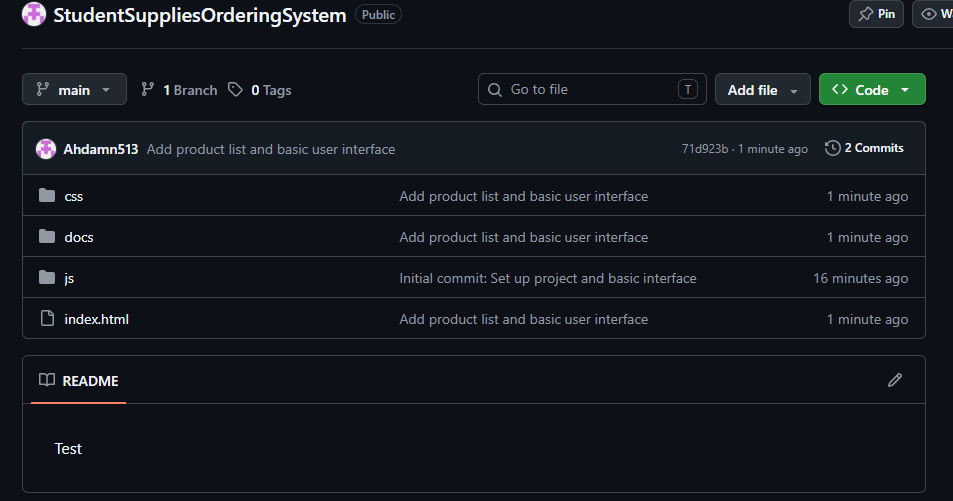

# AI-Assisted Development Documentation
**Project:** Student Supplies Ordering System

## Prompt #1: [First Prompt, the foundation and design of the website]
| Field | Details |
|---|---|

| Prompt Used | 

CONTEXT
I'm a student building a "Student Supplies Ordering System", a
browser-based app for a small school supplies shop near campus.
Customers select school supplies, manage quantities, pay with cash, and
receive a digital receipt. No database or login is needed.

Hard-coded products:
- Ballpen ₱12.00
- Pencil ₱10.00
- Notebook ₱35.00
- Yellow Pad ₱45.00
- Eraser ₱8.00
- Ruler ₱15.00

Features the app will eventually have (do NOT implement logic yet):
- Add to Cart for each product
- Cart showing name, price, quantity, subtotal, with + / - buttons and
  a Remove button
- Order summary with the total amount
- Cash payment with validation and change computation
- Digital receipt and a "New Transaction" button

TASK
Create ONLY the user interface (HTML and CSS). No JavaScript logic yet.
Include these five sections in this order:
1. Product List: all six products with name, price, and an
   "Add to Cart" button each
2. Shopping Cart: a table with columns Product, Price, Quantity,
   Subtotal, Actions, and an empty-cart placeholder row
3. Order Summary: number of items and total amount
4. Payment Section: a cash input, a "Confirm Payment" button, a change
   display, and a message area for errors
5. Receipt Section: hidden-looking placeholder area with a "New
   Transaction" button

CONSTRAINTS
- HTML and CSS only (no frameworks, no libraries, no JavaScript yet)
- Semantic HTML (header, main, section, table, label)
- Product buttons must carry data attributes (data-id, data-name,
  data-price) so JavaScript can read them later
- The payment input must be type="text" with inputmode="decimal" (so
  that non-numeric text like "abc" can be detected later, since
  type="number" hides it)
- Clear id and class names for every element JavaScript will need
- Separate files: index.html and css/style.css, plus an empty script
  tag linking js/app.js at the bottom of the body
- Clean, responsive layout for desktop and mobile
- Short comments for each section

OUTPUT FORMAT
Each file in its own code block, labeled with its path. After the
code, list the element ids and classes I'll need for JavaScript. |


| Purpose | What I wanted the AI to accomplish |

| AI Response | Brief summary or screenshot |

| Your Evaluation | Correct, partially correct, or incorrect, and why |

| Modifications Made | Changes I made before using the output |

## Bugs Found and Fixed
| # | Bug | How I found it | Fix | Commit |
|---|---|---|---|---|

## Lessons Learned
-

## Prompt #2: Generate the cart logic
**Stage:** Implement cart and order calculations (Commit #3)

**Prompt Used:**
```text
CONTEXT
I'm continuing my "Student Supplies Ordering System" project (HTML, CSS,
vanilla JavaScript, no frameworks). The interface is already built in
index.html and css/style.css. I need the cart logic in js/app.js.

What exists in my HTML:
- Six product buttons with class "add-to-cart-btn" inside the element
  with id "product-list". Each button has data-id, data-name, and
  data-price (a plain number such as 12).
- Cart table body: cart-table-body, with a placeholder row
  <tr class="empty-row"><td colspan="5">Your cart is empty.</td></tr>
- Order summary: item-count (number of items), total-amount
- Classes for cart row buttons: .btn, .btn-small, .btn-primary,
  .btn-danger, and .qty-controls (wrapper for the - quantity + group)
- Table columns: Product, Price, Quantity, Subtotal, Actions

TASK
Write the shopping cart logic ONLY. Do NOT implement payment, change,
or the receipt yet (that is a later step). Implement:
1. Add to Cart: clicking a product's button adds it to the cart. If the
   product is already in the cart, increase its quantity by 1 instead of
   adding a duplicate row.
2. Render the cart table: each row shows product name, unit price,
   quantity with - and + buttons, subtotal, and a Remove button. Show the
   "Your cart is empty." row when the cart is empty.
3. Increase and decrease quantity with the + and - buttons.
4. The quantity must never become zero or negative. When the quantity
   would drop below 1, remove the item from the cart.
5. Remove button deletes the whole line.
6. Order Summary updates automatically after every cart change:
   total number of items (sum of all quantities) and total amount.

Formulas:
Subtotal = Unit Price x Quantity
Total Amount = Sum of all item subtotals

CONSTRAINTS
- Vanilla JavaScript in js/app.js only. Do not change the HTML or CSS.
- Use ONE click listener on #product-list (event delegation) for the
  Add to Cart buttons, and one on #cart-table-body for the +, -, and
  Remove buttons (identify the item with a data-id attribute on each
  button, not the array index).
- Read prices with Number(button.dataset.price).
- Keep the cart in one array of { id, name, price, qty } objects.
- Avoid floating-point errors: add a small roundMoney(amount) helper that
  rounds to 2 decimals and never returns -0, and use it for subtotals and
  the total.
- Format money as pesos (e.g., ₱1,250.50) with a formatPeso() function.
- Create table rows safely with createElement and textContent.
- Small, single-purpose functions with clear names (for example
  addToCart, changeQuantity, removeFromCart, getCartTotal, renderCart,
  renderSummary) and a short comment on each.
- Expose getCartTotal() as a normal function so the payment step can
  reuse it later.

OUTPUT FORMAT
1. The complete js/app.js in one code block.
2. A short explanation of how data flows from clicking "Add to Cart" to
   the Order Summary.
3. A test checklist covering: one product, multiple products, same
   product twice, increase, decrease, decrease at quantity 1, remove,
   and the total after each change.
```

**Purpose:**
Generate the shopping cart logic: add to cart, quantity controls, remove, subtotals, and an automatically updating order summary.

**AI Response:**
The AI produced a complete `js/app.js`. The cart is kept in a `cart` array of `{ id, name, price, qty }` objects. Functions include `addToCart`, `changeQuantity`, `removeFromCart`, `getSubtotal`, `getCartTotal`, `getItemCount`, `renderCart`, `renderSummary`, and `updateCartDisplay`, plus helpers `roundMoney` and `formatPeso`. It uses event delegation with one listener on `#product-list` and one on `#cart-table-body`, and each row button carries `data-action` and `data-id`. It also gave a 13-step test checklist.

**Screenshot:**


**Your Evaluation:**
[Correct / partially correct / incorrect, and why. e.g., Add, +, -, and Remove worked, and totals matched the checklist (₱125.00 for all six products). Quantity never reached 0. List any bug you found.]

**Modifications Made:**
- [e.g., changed the empty-cart text / renamed a variable]
- [Add anything else you changed]

---

---

## Prompt #3: Generate payment validation and digital receipt
**Stage:** Add payment validation and digital receipt (Commit #4)

**Prompt Used:**
```text
CONTEXT
I'm continuing my "Student Supplies Ordering System" project (HTML, CSS,
vanilla JavaScript, no frameworks). The cart logic in js/app.js already
works and is tested. I need to add cash payment, validation, change
computation, the digital receipt, and the New Transaction feature.

Existing functions and variables to keep (same names, do not rewrite
their behavior): cart, roundMoney, formatPeso, findCartItem, getSubtotal,
getCartTotal, getItemCount, addToCart, removeFromCart, changeQuantity,
createCell, renderCart, renderSummary, updateCartDisplay, and the two
event listeners (#product-list and #cart-table-body).

Element ids already in my HTML:
- Payment: payment-message (message area), cash-input (type="text",
  inputmode="decimal"), confirm-payment-btn, change-amount
- Receipt: receipt-content (currently holds a placeholder paragraph
  <p class="receipt-placeholder">Your receipt will appear here after
  payment.</p>), new-transaction-btn
- Classes available: .message.error, .message.success, .receipt-placeholder

TASK
Add payment validation, change computation, the receipt, and New
Transaction. Do not change the cart behavior.

1. Confirm Payment (click on confirm-payment-btn). Validate in this
   order, show ONLY the first error in payment-message as .message.error,
   and put the cursor back in cash-input:
   a. Cart is empty -> "Your cart is empty. Add at least one product first."
   b. Cash field is blank (after trimming) -> "Please enter the cash amount."
   c. Not a valid number (for example "abc", "12.5.3", "1e3", "5 0") ->
      "Cash amount must be a valid number."
   d. Negative (for example "-50") -> "Cash amount cannot be negative."
   e. Less than the total amount -> "Cash is not enough. Total due is
      ₱X.XX." (use formatPeso)
   Accepted formats: digits with an optional decimal part such as "100",
   "100.5", "0.50". Use a regular expression for the number check, not
   just Number(), because Number("1e3") and Number("") are misleading.
   Compare using roundMoney on both sides.
2. If the payment is valid: compute Change = Amount Paid - Total Amount
   (rounded with roundMoney), show it in change-amount, show a success
   message in payment-message ("Payment confirmed. Thank you!"), and
   generate the receipt.
3. Receipt (rendered inside receipt-content, replacing the placeholder):
   - Shop title: "Student Supplies Shop"
   - Transaction reference number, format TXN-YYYYMMDD-HHMMSS-NNN where
     NNN is a random 3-digit number
   - Date and time of the transaction
   - A table of purchased items with columns Product, Qty, Unit Price,
     Subtotal
   - Total Amount Due, Amount Paid, Change
   - A payment confirmation line: "PAYMENT CONFIRMED"
4. After a successful payment, the transaction is locked: the Add to
   Cart, +, -, Remove, and Confirm Payment buttons must have no effect
   (use a boolean flag such as isTransactionComplete, and also disable
   the buttons or the cash input as appropriate) until New Transaction is
   clicked. This prevents the receipt from not matching the cart.
5. New Transaction (click on new-transaction-btn): clear the cart, the
   cash input, change-amount (back to ₱0.00), payment-message, and the
   receipt (restore the original placeholder paragraph with the class
   receipt-placeholder), unlock everything, and refresh the cart and
   summary display.

CONSTRAINTS
- Vanilla JavaScript, edit js/app.js only. Do not change the HTML or CSS.
- Build all receipt elements with createElement and textContent (no
  innerHTML with dynamic data).
- Small, single-purpose functions with clear names, for example
  validateCash(text, total) returning an error message or "",
  showPaymentMessage(text, type), generateReferenceNumber(),
  buildReceipt(...), confirmPayment(), startNewTransaction(),
  setTransactionLocked(isLocked). Short comment on each.
- Mark new or changed code with comments such as // PAYMENT or // RECEIPT
  so I can find it.
- The receipt must keep a snapshot of the purchased items (copy them), so
  clearing the cart later cannot affect an already-built receipt.

OUTPUT FORMAT
1. The complete updated js/app.js in one code block.
2. A short explanation of how Confirm Payment flows from click to receipt.
3. A test table with exact inputs and expected results for: blank, "abc",
   "12.5.3", "-50", "0", less than the total, exactly the total, more than
   the total, empty cart, a click on Add to Cart after payment, and New
   Transaction.
```

**Purpose:**
Generate the cash payment feature: validation for empty, non-numeric, negative, and insufficient amounts, change computation, the digital receipt with a reference number and date/time, and the New Transaction reset.

**AI Response:**
The AI produced an updated `js/app.js` that keeps the existing cart code and adds payment, validation, receipt, and transaction locking. `validateCart()` and `validateCash(text, total)` return an error message string (or an empty string when valid) and check in the required order: empty cart, blank, negative, not a valid number, and not enough cash. A regular expression (`/^\d+(\.\d+)?$/`) is used for the number check because `Number()` wrongly accepts `""` and `"1e3"`. `confirmPayment()` computes change with `roundMoney`, copies the cart into a snapshot, builds the receipt with `createElement` and `textContent` (`buildReceipt`, `buildReceiptTable`, `generateReferenceNumber`), and calls `setTransactionLocked(true)`. A boolean flag (`isTransactionComplete`) blocks `addToCart`, `changeQuantity`, and `removeFromCart`, and the buttons are also disabled. `startNewTransaction()` clears the cart, cash input, change, message, and receipt, then unlocks everything. It also gave an 18-row test table.

**Screenshots:**


**Your Evaluation:**
[Correct / partially correct / incorrect, and why. Which tests passed (blank, "abc", "-50", too low, exact amount, new transaction)? Any bug you found, even a small one?]

**Modifications Made:**
- [e.g., changed an error message / changed the shop title / renamed a function]
- [Add anything else you changed]